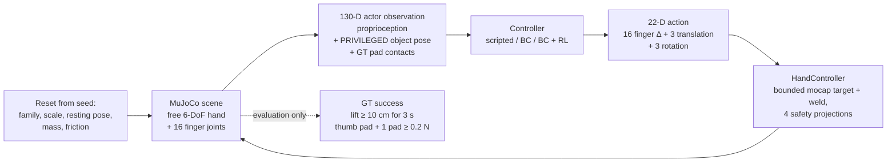

<div align="center">

# VisuoGrasp
### Multi-finger robotic grasping in MuJoCo: from vision-confirmed contact (V3.3) to 6-DoF expert-guided learning (V4)

**Deep Reinforcement Learning · Imitation Learning · MuJoCo · Dexterous Manipulation**

**Authors (MSc students): Madiyar Bolatov, Amanbek Faizolla, Alisher Amangeldy. Astana IT University**

*Final V4 results frozen on 2026-11-15 (SHA-256). V3.3 is frozen and kept unchanged.*

</div>

## Contents

1. [Headline result](#headline-result)
2. [Two project phases](#two-project-phases)
3. [The V4 task](#the-v4-task)
4. [What was tried: Waves 1–5](#what-was-tried-waves-15)
5. [The strongest learned policy: E6](#the-strongest-learned-policy-e6)
6. [Evaluation protocol](#evaluation-protocol)
7. [Failure analysis](#failure-analysis)
8. [Demonstrations](#demonstrations)
9. [Repository layout](#repository-layout)
10. [Running locally (Windows, PowerShell, CPU)](#running-locally-windows-powershell-cpu)
11. [Documents](#documents)
12. [Previous phase: V3.3](#previous-phase-v33)

---

## Headline result

**Wave 5 fresh final test.** Seven controllers were run on the **same 540 episodes**: seeds 6,700,000+,
27 object cells × 2 approaches (top-down, oblique 45°) × 10 episodes. The set was used **once**, after the policies
were frozen, and the reading rule was written before any result was seen.
The metric is ground-truth (GT) success with a Wilson 95 % interval.
All controllers are **PRIVILEGED** (simulator object pose + GT contacts).

| Controller | Kind | All (n = 540) | Top-down (n = 270) | Oblique 45° (n = 270) | Numerical failures |
|---|---|---|---|---|---:|
| Scripted expert | analytic planner + phase machine | 80.6 % [77.0, 83.7] (435) | 96.7 % [93.8, 98.2] | 64.4 % [58.6, 69.9] | 0 |
| BC Wave 4 (`bc4`) | supervised imitation | 77.4 % [73.7, 80.7] (418) | 95.9 % [92.9, 97.7] | 58.9 % [52.9, 64.6] | 1 |
| Improved BC E5g | supervised imitation | 77.4 % [73.7, 80.7] (418) | 93.7 % [90.1, 96.0] | 61.1 % [55.2, 66.7] | 1 |
| BC ensemble (`e5_ens`, 6 members) | supervised imitation | 80.7 % [77.2, 83.8] (436) | 95.9 % [92.9, 97.7] | 65.6 % [59.7, 71.0] | 0 |
| E5c epoch 10 (E6 initialisation) | supervised imitation | 79.4 % [75.8, 82.6] (429) | 96.3 % [93.3, 98.0] | 62.6 % [56.7, 68.1] | 1 |
| **E6** (E5c + 90k steps of BC-anchored RL) | BC + RL fine-tuning | **82.0 % [78.6, 85.0] (443)** | 95.9 % [92.9, 97.7] | **68.1 % [62.4, 73.4]** | 0 |
| E6b (E5g + 130k steps, same method) | BC + RL fine-tuning | 78.5 % [74.9, 81.8] (424) | 93.3 % [89.7, 95.7] | 63.7 % [57.8, 69.2] | 1 |

**Paired comparisons** on the same 540 episodes. The interval is a paired bootstrap (10,000 resamples); "wins" are
discordant episodes; the p-value is an exact McNemar test, Holm-corrected over 12 pre-listed comparisons.

| A − B | Difference [95 % CI] | A-only / B-only wins | p | Holm p |
|---|---|---|---:|---:|
| E6 − its BC initialisation E5c (**RL contribution**) | **+2.6 pp [+0.9, +4.3]** | 18 / 4 | 0.0043 | **0.039** |
| E6b − its BC initialisation E5g (RL, replication) | +1.1 pp [−0.9, +3.3] | 20 / 14 | 0.39 | 1.0 |
| BC ensemble − BC Wave 4 | **+3.3 pp [+1.3, +5.4]** | 26 / 8 | 0.0029 | **0.029** |
| E6 − BC Wave 4 | **+4.6 pp [+2.2, +7.0]** | 34 / 9 | 0.00017 | **0.0020** |
| E6 − BC ensemble | +1.3 pp [−0.4, +3.0] | 14 / 7 | 0.19 | 0.95 |
| E6 − scripted expert | +1.5 pp [0.0, +3.1] | 13 / 5 | 0.096 | 0.58 |
| BC ensemble − scripted expert | +0.2 pp [−1.3, +1.7] | 8 / 7 | 1.0 | 1.0 |

**What the data support**

* E6 has the highest observed GT success (82.0 %).
* E6 significantly improved its own BC initialisation (+2.6 pp, Holm p = 0.039).
  The gain is almost entirely in oblique grasps (+5.6 pp, 16 wins / 1 loss; exploratory sub-group).
* The BC ensemble (imitation only, no RL) matches the scripted expert.

**What the data do not support**

* E6 is better than the scripted expert (p = 0.096) or than the BC ensemble (p = 0.19).
* E6 reliably reaches ≥ 80 %: the Wilson lower bound is 78.6 %.
* The RL gain is robust: the replication E6b was not significant (p = 0.39), and each RL configuration used one
  training seed.
* RL learned grasping by itself: autonomous SAC reached at most 18.9 % (Wave 4, curriculum).
* Any vision-based control.

Sources: `visuograsp_v4/outputs/rl/wave5/final_test/final/` (`episodes.csv`, `analysis/summary.csv`,
`analysis/paired_all.csv`, `analysis/decision.json`) and
[`VERIFIED_RESULTS.md`](visuograsp_v4/outputs/final_defense/evidence/VERIFIED_RESULTS.md).

## Two project phases

| | **V3.3** (previous system, frozen) | **V4** (final project) |
|---|---|---|
| Code | Notebook `main.ipynb` | Python package [`visuograsp_v4/`](visuograsp_v4/) (Gymnasium env, frozen dataclass configs, scripts, smoke tests) |
| Hand | Allegro-style, 4 fingers, 16 flexion joints | Same finger geometry (no abduction joints) |
| Wrist | Fixed vertical orientation; Level B: 3-DoF translation with a scripted prior | Free 6-DoF hand with gravity compensation, driven by a mocap target + weld constraint |
| Action | 16 finger targets (Level A), 16 + 3 (Level B) | 22-D: 16 finger Δ-targets + 3 translation + 3 rotation |
| Contact signal | Vision: D2 temporal CNN–GRU contact detector (M2); GT oracle (M0) as a PRIVILEGED baseline | GT pad contacts (PRIVILEGED) for all learned policies |
| Approaches | Top-down only | Top-down, oblique 45°, side 90° in the planner; learned policies only top-down + oblique |
| Learning | SAC, 3 seeds × 100k steps | SAC, residual SAC, curriculum SAC, BC, BC ensemble, BC-regularised SAC, AWAC-style BC-anchored RL |
| Best learned GT result | Level A SAC M2: 62.6 % (scripted 86.7 %) | E6: 82.0 % (scripted 80.6 %), PRIVILEGED state |

The full V3.3 vs V4 comparison is in
[`V33_V4_COMPARISON.md`](visuograsp_v4/outputs/final_defense/evidence/V33_V4_COMPARISON.md).

## The V4 task



* **Hand and wrist:** a free rigid hand (`hand_free`, 6 DoF) with gravity compensation, welded to a mocap target
  (`solref 0.01 1`). The hand follows through the constraint solver; there is no teleporting.
  Per control step the target moves by ≤ 1 cm per world axis and rotates by ≤ 0.06 rad per hand axis.
  Four projections then apply: workspace box, finger-tilt limit, anti-windup lead limit, and table clearance.
* **Objects:** box (cube / tall / flat), cylinder, bottle, ring, L-shape. Uniform-density geoms give the true centre
  of mass and inertia. Four scale bins (0.85–1.15), mass 0.05–0.30 kg, friction 0.5–1.2, several resting modes and a
  random yaw.
* **Physics:** elliptic cone, impratio 10, noslip 5, dt 2.5 ms (as in V3.3). The **finger armature was raised from
  5e-5 to 1e-3 kg·m²**: with 5e-5, squeezed grasps sometimes launched objects at 10⁵–10¹⁰ m/s (3/486 diagnostic
  episodes with noslip). A runaway detector (object speed > 5 m/s or |position| > 2 m) records such events as
  numerical failures.
* **Success (GT, same as V3.3 and the project specification):** the object's centre of mass is lifted ≥ 10 cm for
  60 consecutive frames (3 s) while the thumb pad and at least one other pad press with ≥ 0.2 N.
* **Scripted expert:** grasp planner (top / oblique 45° / side 90°) plus a phase machine
  (transit → descend → approach → close → lift → hold). It plans from the PRIVILEGED object pose and closes the
  fingers open-loop. It is a reference controller, not a learned policy.

Model, controller and physics details: [`visuograsp_v4/README_V4.md`](visuograsp_v4/README_V4.md).

## What was tried: Waves 1–5

Each wave has its own pre-registered plan and stop gates (`wave*_plan_*.json`) and its own fresh test set, used once.
**Absolute rates are not comparable across test sets:** the same BC Wave 4 policy scored 74.6 % on 6.6M and
77.4 % on 6.7M. Compare each learned policy only with the scripted expert **on the same episodes**.

| Wave | Method | Kind | Learned GT [Wilson 95 %] (k / n) | Scripted on the same episodes | Test seeds | Numerical failures (learned) |
|---|---|---|---|---|---|---:|
| 1 | SAC from scratch | autonomous RL | 0.0 % [0.0, 1.2] (0 / 324) | 77.8 % [72.9, 82.0] (252 / 324) | 5.1M | 13 |
| 1 | SAC + scripted demos in replay | RL with demos | 10.5 % [7.6, 14.3] (34 / 324) | same | 5.1M | 13 |
| 2 | Residual SAC on the scripted controller | residual RL | 49.4 % [44.0, 54.8] (160 / 324) | same | 5.1M | 2 |
| 3 | Conservative residual SAC | residual RL | 69.1 % [65.1, 72.8] (373 / 540) | 76.7 % [72.9, 80.0] (414 / 540) | 6.1M | 0 |
| 4 | Curriculum SAC (E1, no demos) | autonomous RL | 18.9 % [15.8, 22.4] (102 / 540) | 77.8 % [74.1, 81.1] (420 / 540) | 6.6M | 67 |
| 4 | BC + SAC fine-tuning (E2b) | BC + RL | 48.7 % [44.5, 52.9] (263 / 540) | same | 6.6M | 7 |
| 4 | Behaviour cloning | imitation | 74.6 % [70.8, 78.1] (403 / 540) | same | 6.6M | 2 |
| 4 | SAC from scratch, grasp-and-lift sub-task (E3)\* | RL | 55.7 % [51.5, 59.9] (301 / 540) | 77.8 % (same episodes) | 6.6M | 40 |
| 4 | BC + anchored SAC, grasp-and-lift sub-task (E4)\* | BC + RL | 78.9 % [75.2, 82.1] (426 / 540) | 77.8 % (p = 0.53) | 6.6M | 10 |
| 5 | BC ensemble | imitation | 80.7 % [77.2, 83.8] (436 / 540) | 80.6 % [77.0, 83.7] (435 / 540) | 6.7M | 0 |
| 5 | **E6** BC-anchored RL | BC + RL | **82.0 % [78.6, 85.0] (443 / 540)** | same | 6.7M | 0 |

\* Sub-task: the scripted controller brings the hand to the grasp pose; the learned policy takes over at the start of
`close` and performs close, lift and hold. This is an easier task than the full one.

Wave 1 and Wave 2 policies were tested together in the Wave 2 final test (5.1M). Wave 1 validation (8.5M, n = 100):
SAC from scratch 0 %, SAC + demos 8 % [4.1, 15.0], scripted 75 %; both arms were stopped by the pre-registered
150k gate. Training budgets: Wave 1 150k steps per arm, Wave 2 75k, Wave 3 25k (all stopped by their gates),
Wave 4 1.0M learner steps, Wave 5 RL 391k steps. Everything was trained on CPU with one training seed (11) per
configuration.

**Lessons**

1. **Autonomous RL did not learn the full 6-DoF task** within the budget (0 %, 10.5 %, 18.9 %). The dominant failure
   was pushing the object away before the fingers closed.
2. **Residual RL on top of the expert degraded the expert**: 49.4 % vs 77.8 %, and 69.1 % vs 76.7 % with
   conservative bounds.
3. **Standard SAC fine-tuning moved the actor away from BC** (74.6 % → 48.7 %, Wave 4 E2b). The SAC actor loss
   (maximise Q with an entropy term) pulled the actor away from the expert; the Wave 4 analysis also found critic
   over-estimation (E2) and more objects pushed during the approach (E2b).
4. **BC "copycat" problem (Wave 5):** the observation contains the previous action and the finger and wrist
   velocities. Plain BC on more data learned to repeat its own last command: validation MSE kept falling while
   closed-loop success collapsed (DEV_A 0.29 → 0.02–0.06, mostly slow `partial_lift`). Masking or dropping the
   history inputs removed the collapse, but results still varied strongly between epochs.
5. **A BC ensemble** of six members with different input maskings improved on BC Wave 4 by +3.3 pp (Holm p = 0.029),
   entirely in oblique grasps, and matched the expert.
6. **BC-anchored RL (E6)** gave a small, safe gain over its initialisation (+2.6 pp). This is the first RL update in
   the project that significantly improved an already strong policy on a fresh test. It did not replicate in E6b.
7. **The learners inherit the expert's limits.** Oblique ring grasps are 0 / 20 for every controller, including the
   expert; the planner's grasp choice is the bottleneck.

Per-wave reports: `visuograsp_v4/outputs/rl/wave{1,2,3,4,5}/report/report.md`.

## The strongest learned policy: E6

* **Initialisation:** BC actor E5c, epoch 10. It uses the SB3 SAC actor architecture and was trained on the
  successful episodes of 600 clean and 600 DART (σ = 0.05) scripted demonstrations, with the `prev_action` input
  masked.
* **Actor update** (AWAC-style advantage-weighted regression plus a constant BC anchor; `visuograsp_v4/wave5.py`,
  class `AWBCSAC`):

  ```text
  L = mean_batch[ w · ||tanh(μ(s)) − a||² ] + λ_BC · mean_demo ||tanh(μ(s_d)) − a_d||²,   λ_BC = 0.5
  w = exp(A / (τ · std A)), clipped at 20 and normalised;   A = Q(s, a) − Q(s, tanh μ(s));   τ = 1
  ```

  No entropy term (α = 0), fixed exploration σ = 0.05, actor learning rate 1e-4.
* **Critic:** SB3 SAC critics with LayerNorm, n-step 10, γ = 0.99, target Q clamped to [−25, 35].
  25 % of every batch comes from the demonstrations (367,673 transitions). The actor is frozen for the first
  20k updates (critic warm-up).
* **Safety:** the drift from the BC actor stayed ≤ 3e-4 (action MSE) and Q max ≤ 17. The automatic stop rule
  (two DEV_A evaluations below BC − 8 pp) never triggered.
* **Training:** 221,000 environment steps (104.8 min, CPU), stopped by the user after passing the 50k and 150k gates.
* **Selection:** checkpoint 90k (DEV_B 0.755 vs its initialisation 0.730, 200 episodes), frozen with SHA-256 in
  `visuograsp_v4/outputs/rl/wave5/frozen_policies/` (`e6_best_90k.zip`).

## Evaluation protocol

| Purpose | Seeds |
|---|---|
| Diagnosis of the armature problem (consumed, not used for evaluation) | 5,000,000+ |
| Scripted baseline and Wave 1–2 final test | 5,100,000+ (n = 324 for RL policies) |
| Wave 3 / Wave 4 / Wave 5 fresh final tests (540 episodes each, used once) | 6.1M / 6.6M / 6.7M |
| Demonstrations (Wave 5: clean / DART) | 3.6M / 3.7M |
| Validation and selection (Wave 1; Wave 4 dev / selection; Wave 5 DEV_A / DEV_B) | 8.5M; 8.7M / 8.75M; 8.8M / 8.9M |
| Demo videos of the scripted expert | 7,000,001–7,000,010 |

* **Pre-registration:** stop gates, selection rules and final reading rules were written to JSON before the results
  existed. Examples: `wave5/wave5_plan_and_rules.json`, `wave5/final_test/final_decision_rule.json`.
* **Paired design:** every controller sees the identical initial states (one reset seed per episode). Statistics:
  Wilson 95 % intervals, exact McNemar tests, paired bootstrap intervals, Holm correction over pre-listed
  comparisons. Per-family and per-approach tests are exploratory.
* **Determinism:** deterministic actions and `torch.set_num_threads(1)`. With more threads the batch-1 policy output
  differs by ~1e-7, and contact-rich episodes then diverge chaotically.
* **Per-episode data:** every evaluation writes `episodes.csv` with the GT outcome, outcome category and
  numerical-failure flags.
* **Freezing:** checkpoints and BC actors are hashed in `wave5/frozen_policies/manifest.json`; all 78 result files are
  hashed in `wave5/RESULTS_FROZEN_SHA256.txt`.
* **Documented interruption:** Claude Code's memory protection killed the final-test run at 3,029 / 3,780
  episodes. With approval it was resumed with `--resume --workers 1`. The 329 earlier E6 rows are byte-identical
  to the backup, and the final file has 3,780 unique (policy, seed, approach) rows (`analysis/integrity.json`).

## Failure analysis

Outcomes of the failed episodes (gt_success = False) on the Wave 5 final test (540 episodes per controller;
`analysis/outcomes.csv`):

| Controller | Never lifted | Pushed before close | No contact | Held without pad pair | Lifted, then dropped | Total failed |
|---|---:|---:|---:|---:|---:|---:|
| Scripted expert | 57 | 38 | 3 | 0 | 7 | 105 |
| BC Wave 4 | 52 | 53 | 12 | 2 | 3 | 122 |
| **E6** | 46 | 38 | 7 | 3 | 3 | **97** |

* **Ring:** oblique ring grasps succeed 0 / 20 for every controller. Over both approaches the ring reaches only
  37.5–40.0 % (n = 40), the lowest of all families (`analysis/by_family_long.csv`).
* **Numerical failures:** 4 of 3,780 episodes (0.1 %), all `object_runaway` in top-down grasps; 3 of them share one
  initial state (seed 6,711,009, cylinder). All four happened **after** the GT criterion had been met, so the
  standard metric counts them as successes. A strict sensitivity analysis that counts them as failures changes no
  conclusion (`analysis/sensitivity_strict_*.csv`).
* **Side 90° grasps exist only for the scripted expert** (5.1M, n = 162 per approach): top 95.1 % [90.6, 97.5],
  oblique 60.5 % [52.8, 67.7], side 30.2 % [23.7, 37.7]. Restricted to feasible plans (tall objects), side reaches
  61.3 % [43.8, 76.3] (19 / 31). No learned policy was trained or evaluated on side grasps.

## Demonstrations

All V4 clips show **PRIVILEGED state-based control**. Every V4 clip deterministically replays a stored episode
(final-test seeds 6.7M, or scripted demo seeds 7.0M) and reproduced its recorded GT outcome. GIFs are sped up 2–3×;
MP4s play in real time.

| Clip | Controller | Approach / object | GT outcome | Seed | Media |
|---|---|---|---|---|---|
| E6 success | E6 | oblique 45° / bottle | success | 6,715,100 | [GIF](visuograsp_v4/outputs/final_defense/media/gifs/gif_e6_oblique_bottle.gif) · [MP4](visuograsp_v4/outputs/final_defense/media/selected_videos/h264/e6_oblique_bottle_6715100_all_h264.mp4) |
| E6 success | E6 | oblique 45° / L-shape | success | 6,721,100 | [GIF](visuograsp_v4/outputs/final_defense/media/gifs/gif_e6_oblique_lshape.gif) · [MP4](visuograsp_v4/outputs/final_defense/media/selected_videos/h264/e6_oblique_lshape_6721100_all_h264.mp4) |
| E6 success | E6 | top-down / cylinder | success | 6,709,000 | [GIF](visuograsp_v4/outputs/final_defense/media/gifs/gif_e6_top_cylinder.gif) · [MP4](visuograsp_v4/outputs/final_defense/media/selected_videos/h264/e6_top_cylinder_6709000_all_h264.mp4) |
| E6 success | E6 | top-down / ring | success | 6,719,000 | [GIF](visuograsp_v4/outputs/final_defense/media/gifs/gif_e6_top_ring.gif) · [MP4](visuograsp_v4/outputs/final_defense/media/selected_videos/h264/e6_top_ring_6719000_all_h264.mp4) |
| Same episode, expert vs E6 | scripted (top) / E6 (bottom) | oblique 45° / flat box | expert pushes the box, E6 succeeds | 6,706,109 | [GIF](visuograsp_v4/outputs/final_defense/media/gifs/gif_scripted_vs_e6_oblique_box_6706109.gif) · [MP4](visuograsp_v4/outputs/final_defense/media/selected_videos/h264/side_by_side_learned_wins_oblique_box_seed6706109_h264.mp4) |
| E6 failure | E6 | oblique 45° / flat ring | no contact | 6,719,100 | [GIF](visuograsp_v4/outputs/final_defense/media/gifs/gif_e6_fail_ring_oblique.gif) · [MP4](visuograsp_v4/outputs/final_defense/media/selected_videos/h264/e6_fail_ring_oblique_6719100_all_h264.mp4) |
| E6 failure | E6 | oblique 45° / box | pushed before close | 6,706,102 | [GIF](visuograsp_v4/outputs/final_defense/media/gifs/gif_e6_fail_pushed_oblique_box.gif) · [MP4](visuograsp_v4/outputs/final_defense/media/selected_videos/h264/e6_fail_pushed_oblique_box_6706102_all_h264.mp4) |
| E6 failure (expert fails too) | E6 | oblique 45° / box | never lifted | 6,704,100 | [MP4](visuograsp_v4/outputs/final_defense/media/selected_videos/h264/failure_never_lifted_oblique_box_seed6704100_h264.mp4) |
| Side grasp (not learned) | scripted expert | side 90° / tall box | success | 7,000,007 | [GIF](visuograsp_v4/outputs/final_defense/media/gifs/gif_scripted_side_box_tall.gif) · [MP4](visuograsp_v4/outputs/final_defense/media/selected_videos/h264/side_box_tall_h264.mp4) |
| V3.3 (previous system) | V3.3 SAC M2 (D2 vision contact) | top-down, fixed wrist / box | GT 1, CV 1 | — | [GIF](assets/demos/A_train_success.gif) · [MP4](assets/demos/A_train_success.mp4) |

The full media list, with screenshots and the slide and figure where each clip is used, is in
[`DEMO_MEDIA_MANIFEST.md`](visuograsp_v4/outputs/final_defense/DEMO_MEDIA_MANIFEST.md).

## Repository layout

```text
.
├── README.md                    # this file: project overview (V3.3 + V4)
├── README_V3.3.md               # original V3.3 README, byte-identical copy
├── main.ipynb                   # V3.3 research notebook                         (frozen)
├── VisuoGrasp_Report.pdf        # V3.3 report                                    (frozen)
├── VisuoGrasp_Presentation.pdf  # V3.3 presentation                              (frozen)
├── VisuoGrasp_DRL_Grasping_Project_Instructions (1).pdf   # project specification
├── archive_notebooks/           # V3.3 auxiliary notebooks                       (frozen)
├── assets/demos/                # V3.3 demo GIF / MP4                            (frozen)
├── visuograsp_full_outputs/     # V3.3 scenes, detectors, checkpoints, results   (frozen)
└── visuograsp_v4/               # V4 Python package (final project)
    ├── README_V4.md             # physics, controller and seed details
    ├── config.py                # all parameters as frozen dataclasses (V4Config, SACConfig, RewardConfig)
    ├── rotations.py, objects.py, scene.py, sim.py, controller.py
    ├── grasp_planner.py, scripted.py   # approach poses and the scripted expert
    ├── perception.py            # colour segmentation, RGB-D back-projection, D0 contact (not used by policies)
    ├── env.py                   # VisuoGraspV4Env (Gymnasium): 22-D action, 130-D observation
    ├── evaluation.py, video.py  # GT episode runner, MP4 writer
    ├── agents.py, residual.py, wave4.py, wave5.py   # learning code (LayerNorm SAC, residual, BC-SAC, AWBCSAC)
    ├── scripts/                 # training, evaluation, analysis, video and integrity scripts
    └── outputs/                 # all V4 results (local only, see below)
        ├── integrity/           # V3.3 manifest baseline (651 files)
        ├── scripted/            # scripted-expert baseline
        ├── rl/wave1 … wave5/    # runs, plans, gates, selections, final tests, reports, videos
        └── final_defense/       # report PDF, slides, Q&A, verified numbers, media
```

> [!NOTE]
> `visuograsp_v4/outputs/` is listed in `.gitignore`. A git clone contains the V4 code, but **not** its results,
> checkpoints, reports or media. Links into `visuograsp_v4/outputs/` work only in the local working copy.

## Running locally (Windows, PowerShell, CPU)

**Reference environment** (versions used for all V4 results on the development laptop): Python 3.13.2,
MuJoCo 3.17.0, Gymnasium 1.3.0, Stable-Baselines3 2.9.2, PyTorch 2.7.1, NumPy 2.2.4, pandas 2.3.3, SciPy 1.15.2,
Matplotlib 3.10.9, OpenCV 4.13.0, psutil 5.9.5. All V4 training and evaluation ran on the CPU.
The repository has no lock file, and a clean install from the commands below has not been tested.

```powershell
# from the project root
python -m venv .venv
.\.venv\Scripts\Activate.ps1
pip install mujoco==3.17.0 gymnasium==1.3.0 stable-baselines3==2.9.2 numpy==2.2.4 pandas==2.3.3 scipy==1.15.2 matplotlib==3.10.9 opencv-python==4.13.0.92 psutil==5.9.5
pip install torch==2.7.1 --index-url https://download.pytorch.org/whl/cpu
```

**Checks**

```powershell
python -m visuograsp_v4.scripts.run_smoke_tests                  # model, controller, env API, pairing, SB3 interface, V3.3 integrity
python -m visuograsp_v4.scripts.integrity_manifest verify        # compares V3.3 files with the 651-file baseline
python -m visuograsp_v4.scripts.run_scripted_baseline --smoke    # short scripted run -> outputs/scripted/scripted_smoke
```

> [!WARNING]
> * Without `--smoke` or `--out <new_name>`, `run_scripted_baseline` writes into the reference baseline folder.
> * This README replaced the V3.3 `README.md` on 2026-11-15, and `.gitignore` was also edited for the git setup.
>   The integrity check (and the smoke test `test_v33_untouched`) therefore reports these two files as
>   `changed`; all other V3.3 files must still match.
>   [`README_V3.3.md`](README_V3.3.md) has the same SHA-256 as the baseline entry for the original `README.md`.

**Verify the frozen Wave 5 results** (78 files; expected output: `mismatches: 0`):

```powershell
Set-Location visuograsp_v4\outputs\rl\wave5
$bad = 0
Get-Content RESULTS_FROZEN_SHA256.txt | ForEach-Object {
    $h, $p = $_ -split ' \*', 2
    if ((Get-FileHash -LiteralPath $p -Algorithm SHA256).Hash.ToLower() -ne $h) { "MISMATCH $p"; $bad++ }
}
"checked $((Get-Content RESULTS_FROZEN_SHA256.txt).Count) files, mismatches: $bad"
Set-Location ..\..\..\..
```

**Main scripts** (`python -m visuograsp_v4.scripts.<name>`)

| Script | Purpose |
|---|---|
| `train_sac`, `train_residual_sac`, `train_conservative_residual_sac` | Waves 1–3 (SAC from scratch / with demos, residual SAC) |
| `wave4_bc_pretrain`, `train_wave4`, `wave4_eval` | Wave 4 (BC, curriculum SAC, BC + SAC, sub-task) |
| `wave5_collect_demos`, `wave5_bc`, `train_wave5_rl` | Wave 5 demonstrations, improved BC (E5), BC-anchored RL (E6) |
| `wave5_eval` | DEV_B selection (`--stage devb`) and the one-time final test (`--stage final`) |
| `wave5_final_analysis`, `wave5_report`, `record_wave5_videos` | final statistics, figures, videos |
| `validate_checkpoints`, `evaluate_policy`, `paired_compare` | independent validation and paired comparison |
| `integrity_manifest`, `run_smoke_tests`, `benchmark_throughput`, `monitor_system` | checks and system monitoring |

* `wave5_eval` never overwrites results: an existing `episodes.csv` stops the run, and `--stage final` refuses to
  start because the 6.7M test set has already been used.
* Run evaluations with at most 2 workers because of memory; the interrupted final test was resumed with 1 worker.
* Measured SAC throughput is about 50 environment steps/s in one process; long runs take hours.

## Documents

| Document | Path |
|---|---|
| V4 final report (IEEE, 8 pages) | [`VisuoGrasp_V4_Final_Report.pdf`](visuograsp_v4/outputs/final_defense/report/VisuoGrasp_V4_Final_Report.pdf) (source: `report/main.tex`) |
| V4 final presentation (12 slides) | [`VisuoGrasp_V4_Final_Presentation.pptx`](visuograsp_v4/outputs/final_defense/presentation/VisuoGrasp_V4_Final_Presentation.pptx) |
| Verified numbers and their sources | [`VERIFIED_RESULTS.md`](visuograsp_v4/outputs/final_defense/evidence/VERIFIED_RESULTS.md), [`SOURCE_MANIFEST.md`](visuograsp_v4/outputs/final_defense/evidence/SOURCE_MANIFEST.md) |
| Technical Q&A and speaking notes | [`DEFENSE_QA.md`](visuograsp_v4/outputs/final_defense/defense/DEFENSE_QA.md), [`SLIDE_SPEAKING_NOTES.md`](visuograsp_v4/outputs/final_defense/defense/SLIDE_SPEAKING_NOTES.md) |
| Wave 5 report (final experiment) | [`wave5/report/report.md`](visuograsp_v4/outputs/rl/wave5/report/report.md) |
| V4 package details | [`visuograsp_v4/README_V4.md`](visuograsp_v4/README_V4.md) |
| V3.3 report / presentation | [`VisuoGrasp_Report.pdf`](VisuoGrasp_Report.pdf), [`VisuoGrasp_Presentation.pdf`](VisuoGrasp_Presentation.pdf) |
| Project specification | [`VisuoGrasp_DRL_Grasping_Project_Instructions (1).pdf`](<VisuoGrasp_DRL_Grasping_Project_Instructions (1).pdf>) |

## Previous phase: V3.3

V3.3 asked whether a SAC agent can learn multi-finger grasps when the contact signal comes from **cameras** (a D2
temporal CNN–GRU contact detector) rather than from simulator contact flags. The setup was a 16-DoF hand with a
fixed vertical wrist, six training and five unseen object families, and 3 training seeds × 100k steps per
configuration.

* Level A, SAC M2 (D2 vision contact): **62.6 %** nominal GT success (540 episodes pooled over 3 training seeds),
  below the scripted reference (86.7 %) and the ~70 % target.
* The D2 contact input did **not** beat the blind ablation (65.6 %) or the PRIVILEGED oracle M0 (65.2 %).
* CV-confirmed success was lower than GT success (56.7 % vs 62.6 % nominal), so vision missed some valid grasps.
* In the Level B scripted-prior variant, residual SAC (50.9 %) did not beat the hand-designed servo (87.2 %).

V4 extends the task to a free 6-DoF wrist (top-down, oblique and side approaches), which V3.3 did not support.
It studies this harder problem in PRIVILEGED state; the V3.3 vision-based contact signal was not carried over.
The full V3.3 description (tables, demo videos, artifacts, how to run the notebook) is in
[`README_V3.3.md`](README_V3.3.md) and [`VisuoGrasp_Report.pdf`](VisuoGrasp_Report.pdf).

---

<div align="center">

*VisuoGrasp — a grasp counts only when the object is lifted and held.*

</div>
