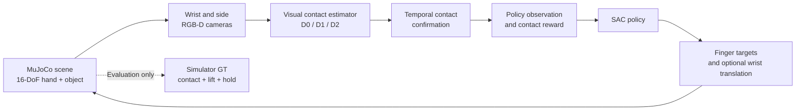
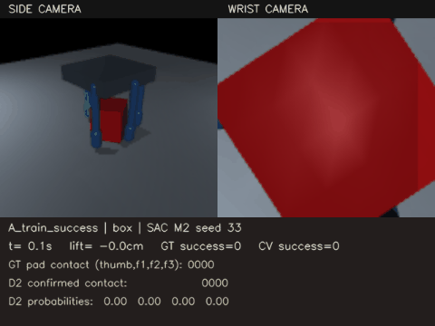
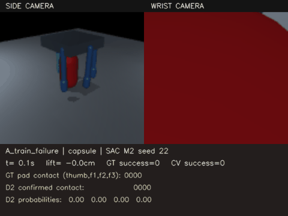
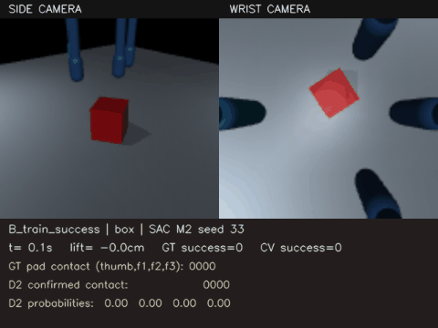
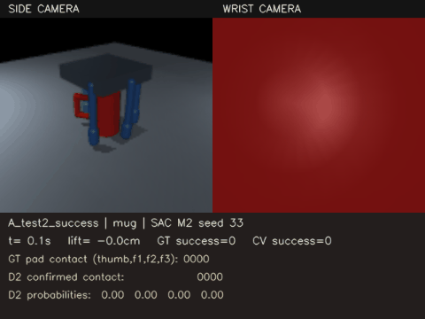

<div align="center">

# VisuoGrasp
### Learning Robotic Grasping with Vision-Confirmed Contact

**Deep Reinforcement Learning · Computer Vision · MuJoCo · Dexterous Manipulation**

*A 16-DoF four-finger hand learns to grasp diverse objects using visual estimates of fingertip contact rather than simulator contact flags.*

**Research prototype | SAC + temporal CNN–GRU | 3 training seeds | 12 completed RL runs**

**Authors (MSc students): Madiyar Bolatov, Amanbek Faizolla, Alisher Amangeldy. Astana IT University**

</div>

---

## The research question

Can a reinforcement-learning agent learn reliable multi-finger grasps when the contact information used for control and reward comes from **cameras**, rather than from privileged simulator contact sensors?

VisuoGrasp investigates the gap between *physical contact*, *visually confirmed contact*, and *successful object manipulation*. In the CV-guided setting, a learned contact detector supplies per-fingertip contact estimates to the SAC agent. Simulator ground truth is reserved for detector supervision, diagnostic analysis, and independent evaluation; the **M0 oracle** is an explicitly privileged comparison.

## System at a glance



- **Robot:** Allegro-style four-finger hand with 16 actuated finger joints.
- **Level A:** 16-DoF finger control, with a scripted lifting phase; no scripted finger-closing prior.
- **Level B (studied variant):** 16 finger joints + 3 wrist-translation actions with a scripted grasp prior and learned residual control. This is **not** a fully autonomous implementation of the original Level B specification.
- **Perception:** wrist and side RGB-D views; D0 geometric, D1 CNN, and D2 temporal CNN–GRU contact detection.
- **Object families:** six training families (sphere, box, cylinder, ellipsoid, capsule, ring) and five unseen families (cone, hexagonal prism, L-shape, mug, bottle).
- **Success definition:** raise the object's center by at least 10 cm and maintain the lift for at least 3 s while two fingertip contacts, including the thumb, are present.

## What was trained

The final V3.3 experiment uses **Soft Actor-Critic (SAC)**, 10-step returns, LayerNorm critics, and observation clipping. Earlier iterations exhibited strongly increasing critic Q estimates; these remained much more stable in the final training logs. This does not guarantee stable policy performance or establish a causal attribution to any single modification.

| Configuration | Contact information | Level | Training seeds | Steps / seed |
|---|---|---|---|---:|
| SAC M2 | D2-confirmed contact + confidence | A | 11, 22, 33 | 100,000 |
| SAC M0 | Privileged simulator contact (oracle baseline) | A | 11, 22, 33 | 100,000 |
| SAC Blind | D2-based reward, contact hidden from the actor | A | 11, 22, 33 | 100,000 |
| SAC M2 | D2-confirmed contact + confidence | B, scripted-prior variant | 11, 22, 33 | 100,000 |

**Total:** 12 RL runs, 1.2 million training environment steps. Earlier diagnostic versions are not mixed into the final results.

## Independent evaluation

The table below contains **ground-truth success rates from the held-out evaluation**, not the peak checkpoint-selection scores. For each SAC configuration, nominal results aggregate 540 episodes across three training seeds; Test-1 aggregates 180 and Test-2 aggregates 300. Baselines were evaluated separately.

| Policy | Nominal (training families) | Test-1 (scale / aspect shifts) | Test-2 (unseen families) |
|---|---:|---:|---:|
| **Level A · SAC M2 (D2)** | **62.6%** | 46.1% | **70.3%** |
| Level A · SAC M0 (oracle) | 65.2% | 61.1% | 80.3% |
| Level A · SAC Blind | 65.6% | 61.1% | 77.7% |
| Level A · Random actions | 43.9% | 38.3% | 57.0% |
| Level A · Scripted grasp | 86.7% | 88.3% | 94.0% |
| **Level B · SAC M2 (residual)** | **50.9%** | 37.8% | 68.7% |
| Level B · Zero residual | 52.8% | 50.0% | 77.0% |
| Level B · Hand-designed servo | 87.2% | 81.7% | 97.0% |

**Interpretation:** On nominal Level A grasps, SAC M2 exceeded the random-action baseline by **18.7 percentage points** but fell below the scripted reference and the project's approximate **70%** target. The final experiment does **not** demonstrate that D2 contact feedback outperforms the blind ablation. In the Level B scripted-prior setting, SAC residual control also failed to outperform the hand-designed servo controller.

### GT success is not CV-confirmed success

For **Level A SAC M2**, the evaluation additionally measured:

| Condition | Physical GT success | CV-confirmed success |
|---|---:|---:|
| Nominal | 62.6% | 56.7% |
| Test-1 | 46.1% | 35.6% |
| Test-2 | 70.3% | 50.0% |

On unseen shapes, a successful physical grasp can therefore go unconfirmed by the vision module. Episode-level CV success is **not** the same quantity as per-frame detector F1.


## Results and Demonstrations

The following demonstrations showcase the behavior of trained SAC agents in MuJoCo, including successful grasps, failure cases, and discrepancies between physical and vision-confirmed contact.

Each video presents wrist and side camera views, lift height, ground-truth (GT) contacts, and D2 vision-confirmed contacts.

### 1. Level A — Successful Grasp

The SAC M2 agent successfully grasps and lifts a box using 16-DoF finger control.



[Watch full video (MP4)](visuograsp_full_outputs/cv_v2/drl_runs_v3_final/videos/v33_final_demos/A_train_success.mp4)

**Outcome:** GT Success = 1, CV Success = 1.

### 2. Level A — Failed Grasp

The agent fails to establish a stable grasp on a capsule-shaped object.



[Watch full video (MP4)](visuograsp_full_outputs/cv_v2/drl_runs_v3_final/videos/v33_final_demos/A_train_failure.mp4)

**Outcome:** GT Success = 0, CV Success = 0.

### 3. Level B — Finger and Wrist Control

The SAC M2 agent controls 16 finger joints and three wrist-translation axes using a scripted grasp prior with learned residual actions.



[Watch full video (MP4)](visuograsp_full_outputs/cv_v2/drl_runs_v3_final/videos/v33_final_demos/B_train_success.mp4)

**Outcome:** GT Success = 1, CV Success = 1.

### 4. Generalization — Unseen Object

The trained agent attempts to grasp a mug-like object from Test-2, containing unseen object families.



[Watch full video (MP4)](visuograsp_full_outputs/cv_v2/drl_runs_v3_final/videos/v33_final_demos/A_test2_success.mp4)

**Outcome:** GT Success = 1, CV Success = 0.

The object is successfully grasped according to simulator ground truth, but the temporal D2 detector does not confirm the grasp. This highlights the difference between physical manipulation success and vision-based contact confirmation.

### Additional Experiment Artifacts

- [Independent evaluation results](visuograsp_full_outputs/cv_v2/drl_runs_v3_final/final_eval/)
- [Learning curves and figures](visuograsp_full_outputs/cv_v2/drl_runs_v3_final/results/v3_report/)
- [Saved SAC checkpoints](visuograsp_full_outputs/cv_v2/drl_runs_v3_final/models/)
- [CV detector weights](visuograsp_full_outputs/cv_v2/detectors/)
- [MuJoCo scenes](visuograsp_full_outputs/scenes/)
- [All demonstration videos](visuograsp_full_outputs/cv_v2/drl_runs_v3_final/videos/v33_final_demos/)

> **Note:** These videos illustrate selected episodes. Quantitative performance is reported separately using independent evaluation results across three training seeds.


## Repository guide

```text
VisuoGrasp_V3_ACTIVE_v33.ipynb             # Main V3.3 research notebook
VisuoGrasp_V33_Demo_Cell1.py              # Demo recording utilities
VisuoGrasp_V33_Demo_Cell2.py              # Demo selection and recording
visuograsp_full_outputs/
  scenes/                                 # MuJoCo XML scenes
  cv_v2/
    detectors/                            # D1/D2 model artifacts
    drl_runs_v3_final/
      models/                             # Selected SAC checkpoints
      logs/                               # Training / evaluation logs
      final_eval/                         # Independent-evaluation outputs
      results/v3_report/                 # Tables and figures
      videos/                             # Recorded demonstrations
```

The full CV image dataset, older experiment archives, and large replay buffers are **intentionally excluded** from Git. A clone therefore provides the documented artifacts and analysis outputs, but **not a completely self-contained reproduction of detector training**.

## Running locally

**Reference development environment:** Windows, Python 3.13, MuJoCo 3.17, Stable-Baselines3 2.9.2, and PyTorch with CUDA support. Exact installations and GPU-specific builds may differ; this repository does not currently provide a locked environment or a one-command reproducibility setup.

1. Clone this repository and prepare a Python environment with the dependencies required by the main notebook.
2. Open [`VisuoGrasp_V3_ACTIVE_v33.ipynb`](VisuoGrasp_V3_ACTIVE_v33.ipynb) in Jupyter or VS Code.
3. Review the `ROOT`, dataset, detector-weight, and model paths before running any experiment.
4. Select the intended stage in the notebook's final control cell: `gate`, `train`, `eval`, or `report`. **The original notebook defaults to `train` when no stage is specified; do not use Run All without checking this setting first.**
5. To capture demonstrations, use the two accompanying demo scripts from an initialized notebook session.

Saved best policies support evaluation and demonstration. Removed replay-buffer snapshots mean that **exact continuation of the historical training run is not supported** by this repository snapshot.

## Limitations and research implications

- The CV-guided policy did not achieve the target nominal GT success rate of approximately 70%.
- Visual contact feedback did not consistently outperform the blind policy; the study does not establish a benefit of visual contact input for grasp success.
- Episode-level CV confirmation missed some valid physical grasps, particularly under shape and scale shift.
- The scripted-prior Level B experiment is a constrained variant, not the fully autonomous wrist-control task.
- The study used three training seeds, a comparatively small 100k-step budget per seed, and a procedural object set. It does **not** include the full YCB Test-3 evaluation or complete TD3/PPO comparison requested in the broader project specification.
- Statistical comparisons should be interpreted cautiously: three training seeds do not support strong claims of superiority across methods.

## Project status

**Completed:** final V3.3 SAC training matrix, independent GT/CV evaluation, success and failure analysis, sensitivity plots, and demo recording.

**Future work:** contact-detector hard-negative mining from RL trajectories, better visual calibration under distribution shift, stronger residual-control baselines, longer multi-seed training, and evaluation on real YCB objects.

---

<div align="center">

*VisuoGrasp — where a visually detected touch must become a physically reliable grasp.*

</div>
